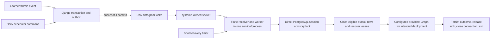

# Phase 1.5: finite worker activation and direct PostgreSQL

These are deployment instructions and illustrative units, not installed services.
No production database, credentials, n8n workflow or live delivery is changed by
the implementation. Linux/systemd and PostgreSQL runtime validation remain gates
until the corresponding isolated checks have actually passed.

## Execution contract



`receive_email_wake` consumes only `library-email-wake-v1`. It requires exactly
one AF_UNIX/SOCK_DGRAM descriptor at fd 3, LISTEN_PID equal to its PID,
LISTEN_FDS=1, and a bound path matching LIBRARY_EMAIL_WAKE_SOCKET. It marks the
descriptor non-inheritable and nonblocking. It never binds, unlinks, calls
shutdown(), launches a subprocess, or invokes systemctl. systemd retains its copy.

It consumes at most 256 datagrams (configurable 1–4096) BEFORE running the worker
once. Invalid/oversized messages are consumed but do not authorize delivery.
Messages arriving during delivery or exit remain unread for systemd to activate
the same service again. Excess messages beyond the read budget remain queued.
There is no blocking receive loop or application daemon. An empty activation
does no database work unless `--recover-if-idle` is explicitly supplied.

With that option, a timer can start the SAME service using the socket inherited
through Sockets=. An empty queue authorizes recovery. An invalid-only batch does
not; another timer/event invocation is needed. A busy advisory lock also leaves
recovery to a later invocation. Signal loss, rate limits and batch exhaustion are
covered by the mandatory recovery timer, not by an assumption of durable signals.

The sender's 100 ms timeout is a best-effort socket-operation bound, not an HTTP
request deadline. Failed wake-ups preserve committed outbox rows.

## Direct database configuration

Both receiver and independent recovery commands MUST use:

```text
--settings=config.email_worker_settings
LIBRARY_EMAIL_WORKER_DATABASE_URL=postgresql://...direct-host.../same-database?sslmode=require&connect_timeout=10
```

Store the value in a protected server environment file, never command arguments
or logs. Do not edit the existing web DATABASE_URL to enable this feature.
The settings module creates a fresh default connection configuration only for
that process, so existing model transactions all use the direct session.
The web settings remain unchanged. No database router or second ORM alias is used.

Missing/malformed URLs, `-pooler` hosts, unknown URL options, client pooling,
different database names and mismatched Neon endpoints fail closed. Neon requires
TLS. Allowed URL options are sslmode and connect_timeout (1–60 seconds). Use the
matching Neon direct endpoint, not a different branch or read replica.
Custom proxies cannot be reliably identified from a hostname: the operator must
verify that any non-Neon endpoint is actually direct to the same application DB.
Do not put PgBouncer transaction pooling or client connection pooling in this path.

The nonblocking session lock uses key 681027243. Acquisition must return a boolean;
unlock must return true. The dedicated connection closes after success, busy,
failure or failed unlock. Commands reject web settings before acquiring a lock.
All managed processing must use drain_outbox via these commands; directly calling
EmailWorker.run_once bypasses the global guard and is not a deployment entry point.

SIGTERM/SIGKILL may prevent Python cleanup. PostgreSQL releases a direct-session
lock when it detects disconnection. A killed submitting attempt becomes uncertain
after lease expiry; it is never automatically replayed. Graceful deployments must
allow ongoing requests to finish. Count limits do not guarantee a wall-clock bound.

## Phase 2 illustrative systemd contract

Replace account/path placeholders for the actual host. All commands below are
future operator actions; nothing has been installed or started locally.
Use one application identity `library` for these examples. If the web application
uses a different account, grant only a restricted socket-writing group.

Provision `/run/library` at boot, for example with a tmpfiles entry:

```text
d /run/library 0750 library library -
```

`library-email.socket`:

```ini
[Unit]
Description=Library email wake socket

[Socket]
ListenDatagram=/run/library/email-wake.sock
SocketUser=library
SocketGroup=library
SocketMode=0600
DirectoryMode=0750
Accept=no
Service=library-email.service
FileDescriptorName=library-email-wake

[Install]
WantedBy=sockets.target
```

`library-email.service` (one receiver AND worker process):

```ini
[Unit]
Description=Finite Library email execution
Requires=library-email.socket
After=library-email.socket network-online.target
Wants=network-online.target
StartLimitIntervalSec=60
StartLimitBurst=10

[Service]
Type=oneshot
User=library
Group=library
WorkingDirectory=/srv/library/backend
EnvironmentFile=/etc/library/email-worker.env
Sockets=library-email.socket
ExecStart=/srv/library/backend/.venv/bin/python /srv/library/backend/manage.py receive_email_wake --settings=config.email_worker_settings --recover-if-idle --limit=20 --max-batches=2 --max-signals=256
Restart=on-failure
RestartSec=15s
RemainAfterExit=no
TimeoutStartSec=1h
TimeoutStopSec=2min
KillMode=control-group
NoNewPrivileges=yes
UMask=0077
TasksMax=16
```

The timeout and task values are starting configuration choices, not measured
capacity guarantees. Set a measured MemoryMax after staging. Type=oneshot runtime
is bounded by TimeoutStartSec, not RuntimeMaxSec. Never impose a short deadline
that routinely kills provider submissions. Per-message failure, busy, more_due
and future retry results can return exit code zero; Restart=on-failure alone is
not recovery. Socket/service start limiting can defer activation; monitor it and
retain the timer. No per-connection template services or privileged systemctl
access from Django are needed.

`library-email-recovery.timer` targets that SAME service:

```ini
[Unit]
Description=Library email recovery after boot and idle intervals

[Timer]
OnBootSec=2min
OnUnitInactiveSec=5min
Unit=library-email.service
AccuracySec=30s

[Install]
WantedBy=timers.target
```

Five minutes is an example recovery delay; choose the actual service-level target.
This is a short-lived timer job, not continuous database polling. The socket must
be active for descriptor inheritance even on timer activation. Boot invocation
recovers durable pending/retry/expired-lease work after restart. `Persistent=true`
does not apply to these monotonic timer expressions.

Independent recovery remains available without any inherited socket:

```text
/srv/library/backend/.venv/bin/python manage.py process_email_outbox --settings=config.email_worker_settings --limit=20 --max-batches=2
```

It uses the same global lock. Do not create additional unmanaged launch paths.

## Scheduler, gates and deployment checklist

- Install a separate oneshot `schedule_email_reminders --limit=1000` service using
  the normal web settings/environment, plus an OnCalendar timer targeting it.
  Set its calendar timezone explicitly for the actual recipient population.
  One or two daily executions can provide same-day coverage only when they reach
  each recipient's eligible window; they do not promise delivery near 09:00.
- The scheduler still uses recipient-local 09:00 through local midnight,
  due-day 0 and overdue days 1,3,5,..., DST validation and idempotent outbox rows.
  Missing a complete local day does not replay that day's reminder. A persistent
  calendar timer can invoke after downtime but does not override application policy.
- Configure LIBRARY_EMAIL_WAKE_SOCKET on web, scheduler and receiver identically.
  Enable LIBRARY_EMAIL_WAKE_ENABLED on producers only after receiver validation.
  No flag is enabled by this change. Receiver/recovery use existing delivery gates.
- Explicitly select LIBRARY_EMAIL_PROVIDER=graph for the intended Graph deployment
  (the repository default is gmail). Verify Graph tenant/client/secret/mailbox,
  permission, recipient allowlist and approved ownership before any live activation.
- Coordinate n8n email ownership without overlapping senders; preserve independent
  overdue state processing. Reconcile cutover-day external sends and shadow rows.
- Validate units on the target systemd version, apply daemon-reload after unit
  changes, enable the socket and both timers at boot, then test fake-provider flows.
  After code/environment changes, ensure the next invocation uses the new version;
  restart web producers when their environment changes. For socket/path changes,
  stop producers/activation in a controlled window, let active delivery finish,
  replace the socket and service together, then restore producers and recovery.
- Log counts/outcomes to the journal without messages, recipients, URLs or secrets.
  Alert on wake errors, invalid-signal bursts, service/start-limit failures, pending
  age, more_due, due retries, expired leases and uncertain/failed states. Investigate
  uncertain delivery rather than automatically resending it.
- Verify actual Linux permissions, burst/queue behavior, arrival-during-exit,
  restart and reboot with fake delivery before enabling any real provider.

## Safe reproducible tests

From the repository root on Windows (PowerShell):

```powershell
$emailTests = @('library.test_email_activation', 'library.test_email_receiver', 'library.test_email_execution_postgres', 'library.test_email_system', 'library.test_email_readiness', 'library.test_stale_loan_emails', 'library.test_notify_conversion', 'library.test_availability_requeue', 'library.test_n8n_email_compatibility')
backend/.venv/Scripts/python.exe -B backend/run_isolated_tests.py --schema-only @emailTests
```

The runner strips application configuration, skips .env, blocks external networking
and delivery, and builds synthetic in-memory tables. PostgreSQL process tests and
the Linux descriptor test explicitly skip on unsupported environments.

With already-installed PostgreSQL binaries, run:

```powershell
backend/.venv/Scripts/python.exe -B backend/run_local_postgres_tests.py --pg-bin 'C:\Path\To\PostgreSQL\bin' --schema-only @emailTests
```

The existing harness requires initdb.exe, pg_ctl.exe and createdb.exe, creates a
fresh temporary cluster on a random loopback port, uses synthetic credentials and
data, then stops ONLY that cluster. It does not load application .env or reuse a
development/production database. It reports the retained temporary directory for
inspection. No binaries were installed for Phase 1.5. Schema-only mode does not
validate migration-created objects; omit --schema-only only for a separate fresh
cluster validation of migrations, never against an existing database.

The seven new PostgreSQL tests use independent Python processes to verify lock
exclusion, normal/exception/crash release, backend termination, a real worker
with a fake provider, claimed-message recovery and uncertain-submission crash recovery. The prior 42
PostgreSQL-only tests cover concurrency, stale messages, conversions and retries.

On Linux, with repository dependencies already available:

```sh
backend/.venv/bin/python -B backend/run_isolated_tests.py --schema-only library.test_email_receiver
```

The Linux-only test exercises real local datagrams, concurrent senders, fd 3
inheritance validation and a late wake in a child process. It does not start
systemd, access an application DB or use a real provider. Full systemd integration
still requires the staging checks above.

## Local verification, 22 November 2026

The documented nine-module isolated suite completed 193 tests: **143 passed,
0 failed, 50 skipped**. The skips are the original 42 PostgreSQL tests, seven new
PostgreSQL process tests and one Linux descriptor test. Git whitespace validation
also passed. The Windows Python build does not provide AF_UNIX; portable receiver
tests therefore use fake sockets explicitly. No PostgreSQL binaries were found on
PATH or in the inspected installation/cache locations, and none were installed.
PostgreSQL concurrency, actual Neon operation and Linux/systemd activation are
**NOT VERIFIED**. This result is implementation readiness, not live-operation sign-off.

## References

- https://www.freedesktop.org/software/systemd/man/latest/sd_listen_fds.html
- https://www.freedesktop.org/software/systemd/man/257/systemd.socket.html
- https://www.freedesktop.org/software/systemd/man/latest/systemd.service.html
- https://www.freedesktop.org/software/systemd/man/latest/systemd.timer.html
- https://neon.com/docs/connect/connection-pooling
